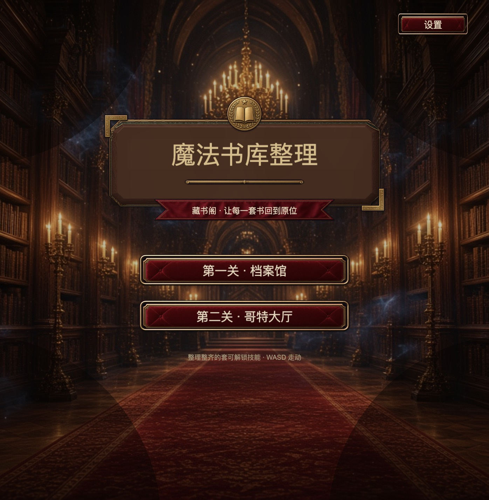
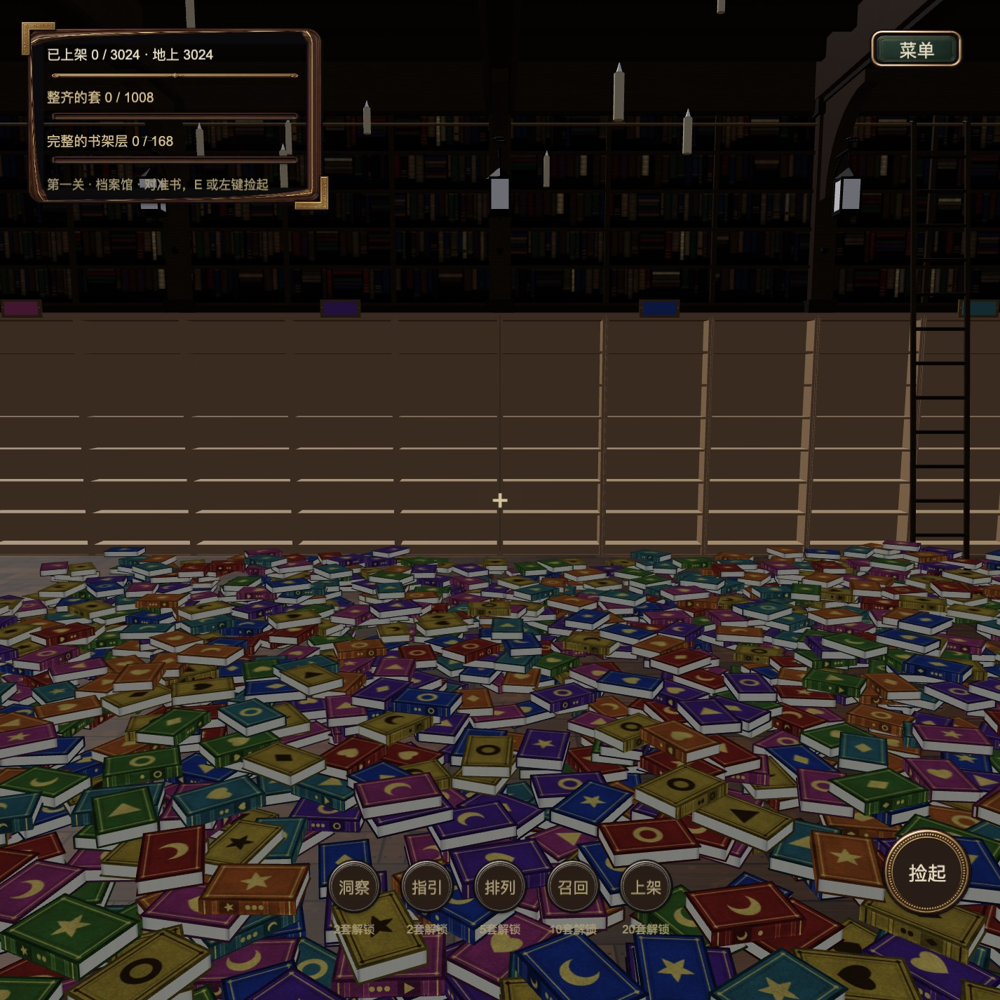

# Magic Library

A first-person library: walk through two halls, pick books off the floor, and
shelve each one in the bay that matches its subject and volume.

## How it works

- `assets/game/MainView.ts` boots the title, the curtain, and one level at a
  time. The curtain stays shut until the hall, shelves, and loose books are
  placed.
- Two levels: the archive (`models/ArchiveHall`) and the gothic hall
  (`models/Hall`). Shelves are instanced bays; loose books are 3024 physics
  copies of one glTF with swapped covers.
- `LibrarySlice.ts` walks, looks, picks, throws, and shelves. A book only
  sticks when the subject and volume match the slot.
- Settings (music, one looping track, effects, look sensitivity, body height,
  candle lights) persist in `localStorage`. Candle flames stay off by default;
  the wick meshes are too heavy to leave on.

## Controls

`W` `A` `S` `D`: walk. Right drag: look. `E` or left click: pick up or shelve.
`Q`: throw the top book. `R`: cycle the stack. `1`–`5`: skills. Settings: the
button on the title, or the in-game menu (pauses play).

## Performance

Candle lights are off unless the settings switch is turned on. With them off,
the cost is the hall draw plus the sleeping book pile. Not frame-timed in this
drop.

Made with Enji 0.3.1.
